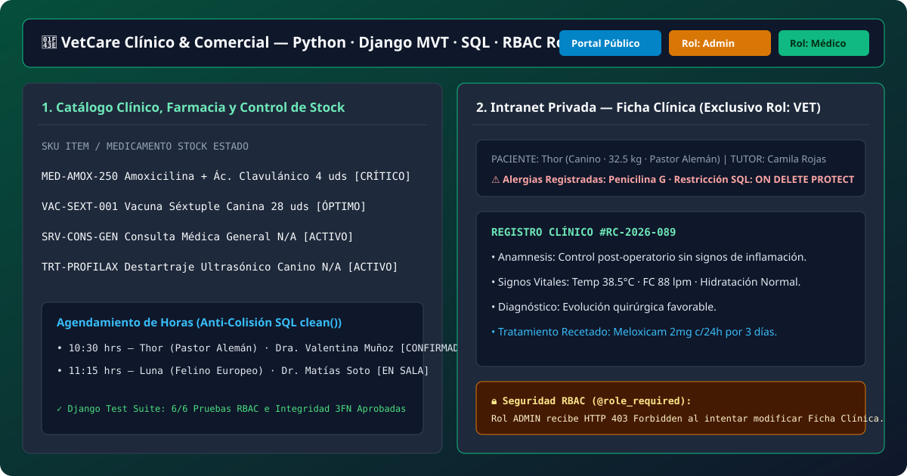
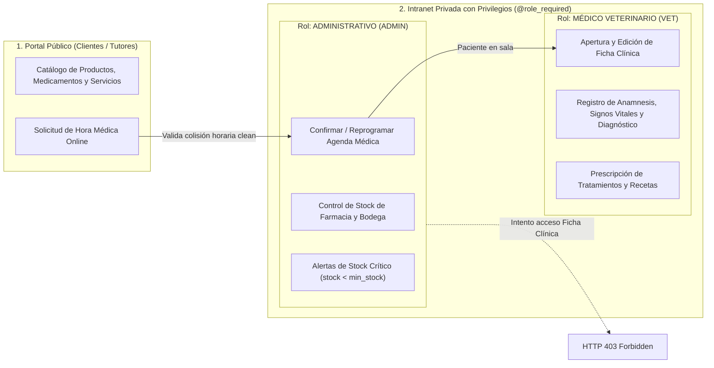
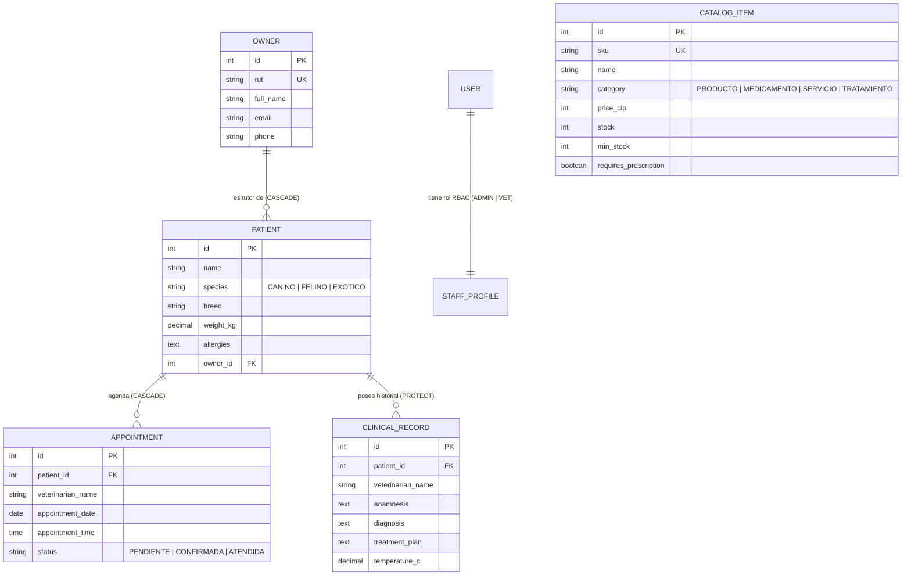

# 🐾 VetCare — Sistema Clínico y Comercial Veterinario (`Django + SQL + RBAC`)

[](https://www.python.org/)
[](https://www.djangoproject.com/)
[](./sql)
[-22c55e)](./tests)
[](https://juancovili.github.io/vetcare-django-system/)

> Sistema web integral desarrollado en **Python / Django** y **SQL**, estructurado en un **Portal Público** (catálogo de medicamentos, productos, servicios, tratamientos y reserva de horas) y una **Intranet Privada con Control de Acceso Basado en Roles (`RBAC`)** que segrega los privilegios entre el personal **Administrativo (`ADMIN`)** y el **Médico Veterinario (`VET`)**.

🔗 **[Probar Demo Interactiva en Vivo (Portal Público + Intranet RBAC)](https://juancovili.github.io/vetcare-django-system/)**



---

## 🏗️ Arquitectura de Permisos y Separación de Capas (`RBAC`)



---

## 🗄️ Modelo Entidad-Relación en 3ª Forma Normal (`3FN`)

El esquema relacional (definido en [`clinic/models.py`](./clinic/models.py) y en SQL nativo en [`sql/schema_and_queries.sql`](./sql/schema_and_queries.sql)) protege el historial médico mediante restricciones de integridad referencial (`ON DELETE PROTECT`):



---

## 🧪 Suite de Pruebas Automatizadas ([`/tests`](./tests))

El directorio [`/tests`](./tests) contiene las pruebas automatizadas de integridad relacional y seguridad por roles:

| Archivo de Prueba | Caso de Prueba | Qué verifica | Estado |
| :--- | :--- | :--- | :---: |
| [`test_models_and_integrity.py`](./tests/test_models_and_integrity.py) | `test_critical_stock_alert_detection` | Propiedad `is_low_stock` detecta insumos farmacéuticos bajo su punto mínimo de reposición. | ✅ PASS |
| [`test_models_and_integrity.py`](./tests/test_models_and_integrity.py) | `test_prevent_double_booking_same_veterinarian` | Validación `clean()` lanza `ValidationError` si se intenta agendar dos citas al mismo médico en igual fecha y hora. | ✅ PASS |
| [`test_models_and_integrity.py`](./tests/test_models_and_integrity.py) | `test_clinical_record_protects_patient_deletion` | Restricción `models.PROTECT` lanza `ProtectedError` impidiendo borrar pacientes con fichas clínicas. | ✅ PASS |
| [`test_rbac_permissions.py`](./tests/test_rbac_permissions.py) | `test_public_catalog_endpoint_accessible_without_login` | Clientes sin sesión pueden consultar el catálogo público (`HTTP 200`). | ✅ PASS |
| [`test_rbac_permissions.py`](./tests/test_rbac_permissions.py) | `test_administrative_staff_cannot_create_clinical_record` | Un usuario `ADMIN` recibe **`HTTP 403 Forbidden`** si intenta emitir una ficha médica. | ✅ PASS |
| [`test_rbac_permissions.py`](./tests/test_rbac_permissions.py) | `test_veterinarian_can_create_clinical_record` | Un usuario `VET` puede registrar fichas clínicas y tratamientos (`HTTP 201 Created`). | ✅ PASS |

```bash
# Ejecutar todas las pruebas
python manage.py test tests
```

---

## 🚀 Cómo Ejecutar en Local

```bash
pip install -r requirements.txt
python manage.py migrate
python manage.py test
python manage.py runserver
```

---

## 👨‍💻 Autor

**Juan Covili**  
*Ingeniero en Informática / Analista Programador (INACAP)*  
* [LinkedIn](https://www.linkedin.com/in/juan-covili-59b935241/) · [GitHub](https://github.com/juanCovili) · [Portafolio Web](https://www.juancovili.com)
